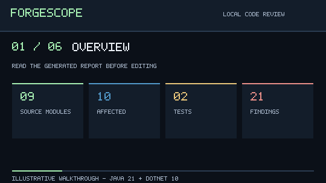

# ForgeScope

[](https://brunnojob.github.io/forgescope/)

*Demostración animada ilustrativa de las seis etapas del informe.*

**Centro web conectado a GitHub: notificaciones de CI para repositorios en cualquier lenguaje.**

Inicia sesión con GitHub, elige **Monitorear fallos de CI** en Repositorios y abre **Notificaciones**. Busca alertas, márcalas como leídas, guárdalas o complétalas. Cada alerta muestra la evidencia disponible y enlaces al commit y a la ejecución. Este flujo no requiere terminal. El análisis semántico sigue siendo específico de cada lenguaje; actualmente los analizadores completos son Java y C#. Consulta [configuración y límites](docs/NOTIFICATIONS.md).

[English](README.md) · [Português](README.pt-BR.md) · [Demostración en español](https://brunnojob.github.io/forgescope/es.html)

ForgeScope reúne análisis de impacto de código, revisión de parches, diagnósticos de CI y mantenimiento del repositorio en un informe local. Integra versiones Java de las reglas de PatchScope, CIFuse, RepoRelief y DevRescue, junto al catálogo de RevScope.

## Flujo unificado

El [recorrido con evidencias reales](https://brunnojob.github.io/forgescope/es.html#pipeline-1) recorre seis fases: **PatchScope** (revisión de diffs), **CIFuse** (CI e imports), **RepoRelief** (mantenimiento), **análisis Java/C#** (dependencias), **RevScope** (detección de artefactos y recomendaciones) y **exportación**.

Pages utiliza datos de ejemplo, incluido un encabezado PCAP vacío. Las reglas integradas son versiones parciales; no ejecuta reparaciones automáticas, decompilación ni emulación de firmware.

## Demostración guiada

Abre la demostración y pulsa **Iniciar demostración**. El recorrido de seis pasos presenta el resumen, las dependencias, las pruebas sugeridas, los analizadores, las referencias y las evidencias. Puedes avanzar, retroceder, cerrar o finalizar. Los enlaces de idioma conservan el paso actual.

La interfaz completa está disponible en español, inglés y portugués de Brasil, incluidos los títulos de hallazgos, las acciones sugeridas, los estados y las limitaciones. Las rutas, los nombres de métodos y las evidencias originales de registros y compiladores se conservan para no alterar su significado. La URL identifica el idioma; también funciona sin conexión.

## Inicio rápido

Instala **JDK 21**, **SDK .NET 10** y **Git**, y copia estos comandos en la terminal:

```sh
git clone https://github.com/brunnojob/forgescope.git
cd forgescope
dotnet build dotnet/ForgeScope.Worker -c Release
dotnet build dotnet/ForgeScope.Workbench -c Release
java tools/Build.java
java -jar build/forgescope.jar examples/sample --changed java/src/shop/Pricing.java --changed csharp/Pricing.cs --diff examples/change.diff --log examples/build.log --csharp-worker dotnet/ForgeScope.Worker/bin/Release/net10.0/ForgeScope.Worker.dll --output .forgescope
```

Abre **`.forgescope/es.html`** para consultar el informe generado localmente. Usa el [tutorial paso a paso](https://brunnojob.github.io/forgescope/es.html#how-it-works) o **Iniciar demostración** en Pages. Pages no ejecuta análisis reales.

## Compilar y ejecutar

Requiere JDK 21 y SDK .NET 10. Git es necesario para comparar revisiones y validar parches.

```sh
git clone https://github.com/brunnojob/forgescope.git
cd forgescope
dotnet build dotnet/ForgeScope.Worker -c Release
dotnet build dotnet/ForgeScope.Workbench -c Release
java tools/Dependencies.java
java tools/Build.java test
java -jar build/forgescope.jar examples/sample --changed csharp/Pricing.cs --diff examples/change.diff --log examples/build.log --csharp-worker dotnet/ForgeScope.Worker/bin/Release/net10.0/ForgeScope.Worker.dll --output .forgescope
```

Abre `.forgescope/es.html` para ver el informe sin conexión. Para el panel local con filtros y nuevos análisis:

```sh
dotnet dotnet/ForgeScope.Workbench/bin/Release/net10.0/ForgeScope.Workbench.dll --report .forgescope/report.json --repo examples/sample --jar build/forgescope.jar --worker dotnet/ForgeScope.Worker/bin/Release/net10.0/ForgeScope.Worker.dll
```

Visita `http://127.0.0.1:8765/?lang=es`. Selecciona el idioma y aplica los filtros. Las nuevas ejecuciones conservan el idioma y el tema. GitHub Pages presenta el ejemplo; los análisis de tus repositorios se ejecutan localmente.

## Límites

Las dependencias indican impacto potencial y no demuestran fallos. Los analizadores Java y C# usan un entorno de compilación aislado, sin ejecutar el proyecto. Los avisos de revisión son heurísticos y no constituyen una auditoría de seguridad. Los tests candidatos no representan cobertura medida. La compatibilidad con Python se limita a imports léxicos. Revisa los informes antes de compartirlos.

[Arquitectura](docs/ARCHITECTURE.md) · [Migración](docs/MIGRATION-0.3.md) · [Licencias](third_party/README.md)

MIT. God first.

## Hub con acceso GitHub

[ForgeScope Hub](docs/HUB.md) añade acceso con GitHub, investigaciones por repositorio/commit, importación opcional de logs de GitHub Actions, historial PostgreSQL, planes versionados con bloqueos y validación de parches mediante un ejecutor local de confianza. La interfaz ofrece ES/EN/PT-BR y temas claro/oscuro. La publicación requiere configurar la OAuth App, la conexión a la base existente y las claves persistentes del servidor. Pages sigue siendo la demostración estática; el acceso y la base funcionan en el Hub. Consulta la guía para el despliegue en Azure y el flujo completo.
