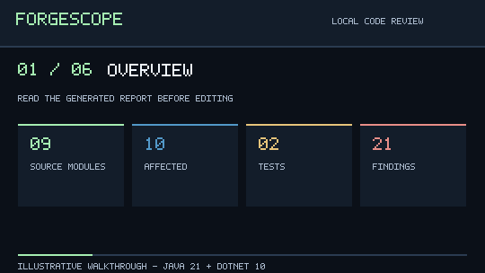

<div align="center">

# ForgeScope

[](https://brunnojob.github.io/forgescope/)

<sub>Illustrated six-stage walkthrough of the sample report. Not a live screen recording.</sub>

### Evidence before edits. Code impact, CI diagnostics and actionable evidence in one local workbench.

**Java 21 core. C#/.NET 10 workbench and Roslyn analysis.**

[Evidence-backed tour](https://brunnojob.github.io/forgescope/#pipeline-1) · [Tutorial](https://brunnojob.github.io/forgescope/#how-it-works) · [Português](README.pt-BR.md) · [Español](README.es.md) · [Architecture](docs/ARCHITECTURE.md) · [Migration notes](docs/MIGRATION-0.3.md)

[](https://github.com/brunnojob/forgescope/actions/workflows/ci.yml)


</div>

Changing unfamiliar code means reconstructing dependencies, reviewing patches, reading CI logs and finding maintenance work across separate tools. ForgeScope puts those evidence streams into one local investigation report.

**Version 0.3 migrates application logic to Java and C#. Python and Node are no longer runtime or build requirements.** HTML/CSS remain presentation formats. The portable report uses native HTML/CSS for language navigation and a six-step guided tour. The interactive localhost workbench runs its application logic in C# on ASP.NET Core.

## Unified investigation pipeline

ForgeScope runs a **local Java/.NET investigation** and presents its evidence in one report. The [six-stage live-report tour](https://brunnojob.github.io/forgescope/#pipeline-1) reads **actual findings from the bundled fixture**, rather than hard-coded marketing screenshots.

| Source project | ForgeScope capability | Boundary |
| --- | --- | --- |
| [PatchScope](https://github.com/brunnojob/patchscope) | Unified diff review: sensitive changes, privileged workflows, action pinning and test-scope prompts | A subset of PatchScope rules, not full feature parity |
| [CIFuse](https://github.com/brunnojob/cifuse) | CI-log grouping with redacted context and source locations, plus bounded JS/TS relative-import checks | Not the full CIFuse repair/PR workflow; no automatic fix claims |
| [RepoRelief](https://github.com/brunnojob/reporelief) | README, license, workflow, broken-link, TODO/FIXME and conventional test-name audit | Heuristic maintenance checks, not measured coverage |
| Java/Roslyn impact | Java AST / Roslyn source dependency paths and test candidates | No target build graph, generated-code evaluation or runtime proof |
| [RevScope](https://github.com/brunnojob/revscope) | File-header triage and a browsable **22-tool** offline catalog with localized descriptions | No packet decoding, decompilation, firmware emulation or binary execution |

To run an investigation on your own checkout, use the [Quick start](#quick-start). The published Pages report uses the synthetic **Java/C# + CI/diff + empty PCAP header** fixture; this allows visitors to verify the steps without uploading code. Outputs are HTML, JSON, SARIF and Markdown. Inspect reports before sharing because paths and original evidence may remain sensitive.

## What is implemented

| Capability | Implementation | Boundary |
| --- | --- | --- |
| Java impact | JDK compiler AST and source symbol bindings, with annotation processing disabled | Isolated source compilation; not the target project's build graph |
| C# impact | Roslyn syntax and semantic models in a .NET worker | No MSBuild evaluation, project analyzers or source generators |
| Review prompts | Java ports of PatchScope rules | Heuristic diff review, not a security audit |
| CI diagnostics | Java ports of CIFuse/DevRescue rules, plus Java, C#, MSBuild, .NET SDK and NuGet diagnostics | Pattern matches and source links, not proof of root cause |
| Maintenance | Java implementation of repository essentials, relative Markdown targets, maintenance markers and conventional test naming | Heuristics; no measured test coverage |
| Analysis guidance | RevScope catalog snapshot and artifact signals | No binary execution, decompiler or firmware extractor |
| Reports and history | Java HTML/JSON/Markdown/SARIF exporters and optional SQLite JDBC history | Reports retain derived evidence; review them before sharing |
| Local interface | C# ASP.NET Core, server-rendered filters, dependency paths, EN/PT-BR/ES, light/dark themes, exports and a local scan form | Binds only to 127.0.0.1; configured repository only; no cloud account |

An import/reference path shows potential impact. A shared file or missing symbol does not independently prove that a change caused a failure. External dependencies absent from the isolated compiler environment produce visible diagnostics rather than invented certainty.

## Quick start

Install **JDK 21**, **.NET 10 SDK** and **Git**, then copy these commands into a terminal:

```sh
git clone https://github.com/brunnojob/forgescope.git
cd forgescope
dotnet build dotnet/ForgeScope.Worker -c Release
dotnet build dotnet/ForgeScope.Workbench -c Release
java tools/Build.java
java -jar build/forgescope.jar examples/sample --changed java/src/shop/Pricing.java --changed csharp/Pricing.cs --diff examples/change.diff --log examples/build.log --csharp-worker dotnet/ForgeScope.Worker/bin/Release/net10.0/ForgeScope.Worker.dll --output .forgescope
```

Open **`.forgescope/index.html`** in your browser to inspect the real locally generated sample report. For explanations, use the [step-by-step tutorial](https://brunnojob.github.io/forgescope/#how-it-works) or the existing six-stage **Start demonstration** tour. GitHub Pages shows sample evidence and does not run a live scan.

## Build and run

Requires a **JDK 21** and **.NET 10 SDK**. Git is required for `--base` and patch validation. The JDK source launcher is sufficient; Maven is optional.

```sh
git clone https://github.com/brunnojob/forgescope.git
cd forgescope

dotnet build dotnet/ForgeScope.Worker -c Release
dotnet build dotnet/ForgeScope.Workbench -c Release

# Optional SQLite dependencies: explicit download with pinned SHA-256 checks
java tools/Dependencies.java
java tools/Build.java test
```

The .NET worker references Roslyn shipped with the SDK. No third-party NuGet packages are needed. The explicit Java dependency step downloads SQLite JDBC and SLF4J from Maven Central into `build/lib`; a normal scan never downloads anything. The Java compiler and report features work without those JARs; `--history` requires them.

Generate the reproducible Java/C# fixture report:

```sh
java -jar build/forgescope.jar examples/sample --changed java/src/shop/Pricing.java --changed csharp/Pricing.cs --diff examples/change.diff --log examples/build.log --csharp-worker dotnet/ForgeScope.Worker/bin/Release/net10.0/ForgeScope.Worker.dll --output .forgescope --fail-on engine-error
```

Open `.forgescope/index.html` directly for a portable, offline report. Use the language links for **Português (Brasil), English or Español**; the entire interface, generated findings, actions, limitations and tour change together. Source paths, identifiers and original log/compiler evidence stay unchanged. The selection is encoded in the page URL and works offline. Click **Start demonstration** for a six-step tour with previous, next, close and finish controls. Each tour step also offers language links that retain the current step. For the full local interface:

```sh
dotnet dotnet/ForgeScope.Workbench/bin/Release/net10.0/ForgeScope.Workbench.dll --report .forgescope/report.json --repo examples/sample --jar build/forgescope.jar --worker dotnet/ForgeScope.Worker/bin/Release/net10.0/ForgeScope.Worker.dll
```

Visit **http://127.0.0.1:8765**. Use the GET form to filter findings, select a source file, choose Portuguese/English/Spanish or switch theme. The POST scan form uses a random nonce, checks browser origins and invokes the Java CLI with explicit arguments, without a shell. It can scan only the repository configured at startup. Omit `--repo` and `--jar` for read-only report viewing. To scan the non-Git fixture, clear the Git base field and provide one of its source paths.

GitHub Pages hosts only the static fixture report. It cannot run Java, ASP.NET Core, Roslyn or SQLite. All interactive scans happen locally.

### Your repository

```sh
java -jar build/forgescope.jar /path/to/project --base HEAD~1 --csharp-worker dotnet/ForgeScope.Worker/bin/Release/net10.0/ForgeScope.Worker.dll --output .forgescope
java -jar build/forgescope.jar /path/to/project --changed src/shop/Pricing.java --symbol shop.Pricing.total --output .forgescope
java -jar build/forgescope.jar /path/to/project --baseline previous/report.json --history history.sqlite --output next-report
```

`--base` compares a local commit to tracked working-tree content, including staged changes, relative to the selected directory. It is not a merge-base comparison. Untracked files require `--changed`. External diff/textconv drivers and fsmonitor hooks are disabled. `--diff` accepts a supplied unified patch and is mutually exclusive with `--base`.

Each run writes `report.json`, `report.md`, `report.sarif` and `index.html`. `--fail-on high` returns 1 for high-priority findings; `--fail-on engine-error` returns 2 when a required analyzer fails or is unavailable. C# files without an explicit worker are reported as unavailable. Python files use limited lexical import compatibility and are labeled accordingly.

### Optional Maven build

```sh
mvn package
java -jar target/forgescope-0.3.0.jar /path/to/project --history history.sqlite
```

Maven runs the Java regression checks and produces a shaded JAR with SQLite dependencies. The source-launcher build and CI also verify Java-to-Roslyn integration. No Maven invocation is required when using `tools/Build.java`.

## Validate a reviewed patch

Use a clean, committed **trusted** Git repository. This separate command intentionally executes your explicit test argv before/after applying a supplied patch in a disposable detached worktree:

```sh
java -jar build/forgescope.jar validate /path/to/trusted/project /path/to/reviewed.patch --test-command '["dotnet","test","--no-restore"]' --output validation.json
```

Success requires failing tests before and passing tests after. The original checkout is preserved. The temporary checkout is cleaned between runs. This isolates edits, **not execution privileges**: tests can access files and networks, and process-tree termination is best effort. No log-derived commands, generated repairs or automatic PR publication are used.

## Honest migration boundaries

- Java and C# analysis now resolves symbols through their compiler APIs. Runtime dispatch, reflection, external project references and generated code remain incomplete.
- The former Python AST implementation is preserved in Git history. Version 0.3 offers import-only lexical Python compatibility; it does not claim equivalent Python function/scope analysis. See [migration notes](docs/MIGRATION-0.3.md).
- Ports preserve the investigation workflow, not every upstream implementation detail or byte-identical output. Rule wording and fingerprints can differ across the 0.2/0.3 boundary.
- SQLite retains the existing `runs` table schema. Existing history is not replaced, migrated or deleted. Old JSON reports remain readable by the local workbench.
- Inventory skips symlinks, `.env` names, common generated directories, binary/invalid UTF-8 and files over 512 KB; text scans are capped at 10,000 files / 20 MB. Logs: 20 files / 2 MB total. Patches: 2 MB / 500 sections / 60,000 lines.
- Redaction is pattern based and incomplete. Reports can contain sensitive filenames and evidence snippets. No quality, security or accuracy percentage is invented.

## Verify

```sh
dotnet dotnet/ForgeScope.Worker/bin/Release/net10.0/ForgeScope.Worker.dll --self-test
dotnet dotnet/ForgeScope.Workbench/bin/Release/net10.0/ForgeScope.Workbench.dll --self-test
java tools/Build.java test
```

To include cross-runtime protocol checks in the Java test process, set `FORGESCOPE_CSHARP_WORKER` to the built worker DLL. CI does this on Windows and Linux, with JDK 21, .NET 10 and SQLite dependencies. The CI artifacts contain the Java JAR, JDBC libraries, C# worker/workbench outputs and derived reports.

## Credits

Original project references and pinned commits are in [provenance.json](src/main/resources/provenance.json). Original MIT notices are retained in [third_party/licenses](third_party/licenses); dependency notices are in [third_party/README.md](third_party/README.md). PatchScope, CIFuse, RepoRelief, DevRescue and RevScope remain independent repositories.

God first. Build useful things, and make the evidence inspectable.
